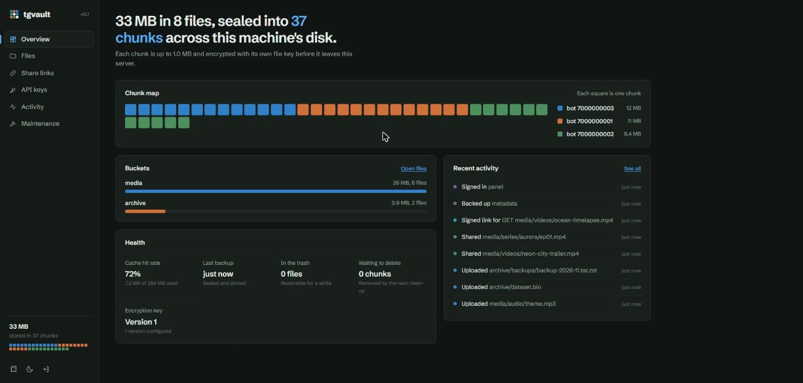
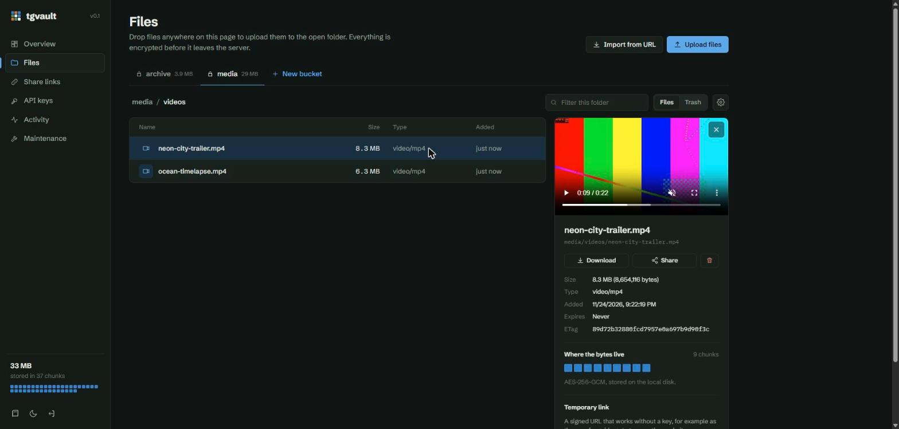
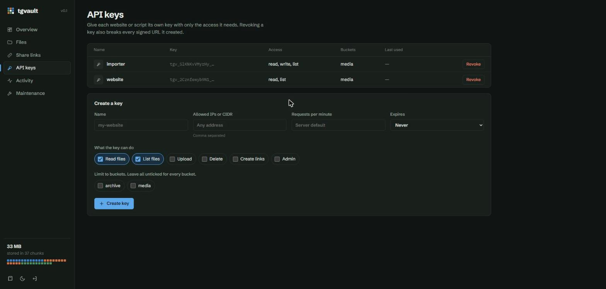
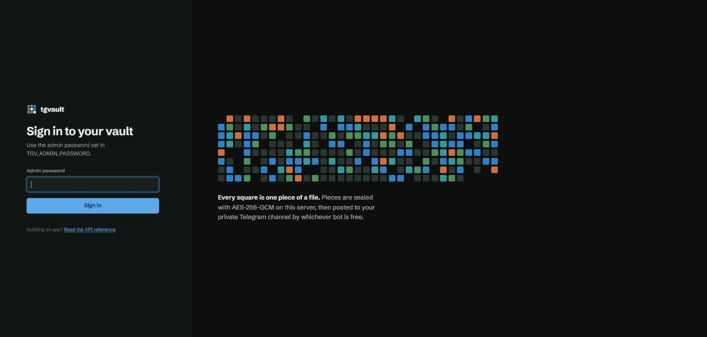
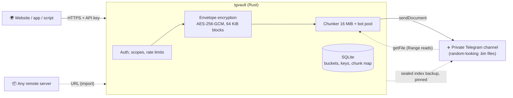

<div align="center">



# 🗄️ tgvault

### Encrypted, S3-style object storage that keeps its bytes in Telegram.

Stream video with `Range`, hand out signed links, import files straight from any URL, and run it all behind scoped API keys. One self-contained Rust binary and one SQLite file.

<p>
  
  
  
  
</p>
<p>
  
  
  
  
</p>

[**Quick start**](#-quick-start) · [**Features**](#-features) · [**How it works**](#-how-it-works) · [**API**](#-use-it-from-your-website) · [**Security**](#-security-model) · [**Docs**](#-documentation)

</div>

---

> [!NOTE]
> tgvault is an independent project and is not affiliated with Telegram. Use it within [Telegram's Terms of Service](https://telegram.org/tos), keep independent backups of anything important, and only store content you have the right to store.

## ✨ What it is

tgvault turns a private Telegram channel into a bucket-based file store with a real HTTP API, so your website, scripts and apps can treat it like a tiny, self-hosted R2 or S3:

- 🔐 **Always encrypted.** Files are sealed on your server before a single byte reaches Telegram.
- 🎬 **Built for video.** Range requests, seeking and ETags work, and a seek only decrypts the 64 KiB blocks it touches.
- 🔗 **Remote import.** Give it a URL and the server downloads, encrypts and stores the file for you. Nothing is relayed through your machine.
- 🤖 **Many bots, one vault.** Uploads fan out across several bots and back off politely when Telegram rate-limits one.
- 🛡️ **Scoped API keys.** Per-bucket, per-IP, rate-limited and expiring, in the spirit of R2 API tokens.
- 🖥️ **A proper panel and API docs** included in the same binary.

## 🖼️ A look inside

<table>
  <tr>
    <td width="50%"><br><sub><b>Files</b>: preview, share, and see which bot holds each chunk of a file.</sub></td>
    <td width="50%"><br><sub><b>API keys</b>: scopes, buckets, IP allowlists, rate limits, expiry.</sub></td>
  </tr>
  <tr>
    <td colspan="2"><br><sub><b>Sign in</b>: the artwork is a chunk map. Every square is one piece of a file.</sub></td>
  </tr>
</table>

<sub>Screenshots use throwaway demo data on a local test server. The bot ids shown are fake.</sub>

## 🚀 Quick start

You need Rust (stable), a Telegram account, and 5 minutes.

**1. Create the Telegram side**

1. Talk to [@BotFather](https://t.me/BotFather), send `/newbot`, and keep the token. Make 1 to 4 bots for more throughput.
2. Create a **private channel**, add each bot as an **administrator** with *Post messages*, *Delete messages* and *Pin messages*, then post any message in it.

**2. Build and configure**

```bash
git clone https://github.com/IzumKonata-Thaoo/tgvault.git && cd tgvault
cargo build --release

# Windows: guided setup (finds your channel id, generates keys, writes .env, tests Telegram)
./scripts/setup.ps1

# Linux/macOS: do it by hand
export TGV_BOT_TOKENS="123456:AAA..."
./target/release/tgvault telegram-chats        # prints your channel id (-100…)
./target/release/tgvault gen-secrets           # prints TGV_MASTER_KEYS and TGV_SERVER_SECRET
cp .env.example .env                           # fill everything in
set -a; . ./.env; set +a
./target/release/tgvault telegram-check        # real upload, download and delete through each bot
./target/release/tgvault                       # panel at http://127.0.0.1:8787
```

A passing check looks like this:

```text
ok   chat -100…: 'my-vault' (channel)
ok   @my_vault_bot: administrator with the needed rights
ok   @my_vault_bot: upload, download and delete work (812 ms)
Telegram setup is ready.
```

No Telegram yet? Set `TGV_BACKEND=local` to try everything against a folder on disk. Full walkthrough: [docs/SETUP-TELEGRAM.md](docs/SETUP-TELEGRAM.md).

**Docker**

```bash
docker build -t tgvault . && docker run --env-file .env -p 8787:8787 -v tgvault:/data tgvault
```

> [!WARNING]
> Back up `TGV_MASTER_KEYS` somewhere safe (a password manager). If you lose it, the data in Telegram **cannot** be decrypted. Changing `TGV_SERVER_SECRET` invalidates every API key and link.

## 🧩 Features

<table>
<tr>
<td valign="top" width="33%">

### 🔒 Storage and crypto
- AES-256-GCM, a fresh data key per file
- Versioned master keys, rotate without re-uploading
- 64 KiB authenticated blocks bound to position
- Multi-bot pool with flood-wait handling
- Deduplicated copies via reference counting
- Garbage collection of orphaned chunks

</td>
<td valign="top" width="33%">

### 🌐 API and delivery
- `Range`/206, `If-None-Match`/304, `HEAD`
- Chunk cache holding ciphertext, single-flight, prefetch
- Multipart uploads (parallel, resumable parts)
- Remote import from any public URL
- Signed GET/PUT URLs with expiry
- Public buckets and per-bucket CORS

</td>
<td valign="top" width="33%">

### 🛡️ Control and safety
- Scoped, expiring, IP-limited API keys
- Share links with password, expiry, download cap
- Trash with restore, TTLs, bucket quotas
- Audit log of every change and sign-in
- Rate limits per key and per IP
- Encrypted metadata backups pinned in Telegram

</td>
</tr>
</table>

## 🔬 How it works



1. **Upload** streams into 16 MiB chunks. Each is sealed block by block, then posted to the channel by whichever bot is free.
2. **The map** (which chunk lives where, in which order, under which key) is stored in SQLite and backed up, encrypted, into the channel itself.
3. **Read** looks up the chunks for the requested byte range, fetches only those, and decrypts only the blocks needed. That is what makes video seeking cheap.
4. **Telegram only ever sees** opaque, authenticated ciphertext. File names, types and keys never leave your server.

<details>
<summary><b>Why not just use the existing projects?</b></summary>

tgvault was designed after reading several Telegram-as-storage projects: [teldrive](https://github.com/tgdrive/teldrive), [TG-FileStreamBot](https://github.com/EverythingSuckz/TG-FileStreamBot), [tgDrive](https://github.com/SkyDependence/tgDrive) and [TGDrive](https://github.com/TechShreyash/TGDrive). All of them are good at what they do. tgvault makes different trade-offs:

| Topic | tgvault |
|---|---|
| Encryption | Always on. Envelope encryption with per-file keys and rotatable master keys. |
| Seeking | Fixed-size authenticated blocks, so a range read decrypts only what it needs. |
| Throughput | Multi-bot pool. Each chunk remembers its bot, because Telegram `file_id`s are bot-specific. |
| Disaster recovery | Sealed metadata backup pinned in the channel. `tgvault restore` needs only bot tokens and master keys. |
| Access control | R2-style scoped API keys, signed URLs and per-bucket CORS instead of one shared password. |
| Footprint | One self-contained binary and one SQLite file, with the panel and API docs embedded. |

No code was copied from these projects.

</details>

## 🌐 Use it from your website

Upload, then hand the browser a signed link. **Never put an API key in browser code.**

```bash
# 1. your backend uploads
curl -H "Authorization: Bearer $TGV_KEY" -H "Content-Type: video/mp4" \
     -T trailer.mp4 https://vault.example.com/api/v1/buckets/media/objects/trailer.mp4

# 2. your backend asks for a link that expires
curl -H "Authorization: Bearer $TGV_KEY" -H "Content-Type: application/json" \
     -d '{"bucket":"media","key":"trailer.mp4","expires_in":3600}' \
     https://vault.example.com/api/v1/presign
```

```html
<video src="https://vault.example.com/p/media/trailer.mp4?m=GET&exp=…&sig=…" controls></video>
```

Add your site's origin to the bucket's CORS list in the panel and seeking just works.

### 📥 Import from another server

```bash
curl -H "Authorization: Bearer $TGV_KEY" -H "Content-Type: application/json" \
     -d '{"url":"https://media.example.com/ep01.mp4","key":"series/ep01.mp4","wait":true}' \
     https://vault.example.com/api/v1/buckets/media/import
```

The server fetches the URL itself and streams it, encrypted, into Telegram. Without `"wait": true` you get a job id to poll. Folders are just `/` in the key. For batches there is a ready-made client, [`tools/tgv_import.py`](tools/tgv_import.py).

> [!IMPORTANT]
> Import only fetches **public Internet** addresses. Loopback, private ranges, link-local and cloud-metadata addresses are refused, including after DNS resolution and on every redirect. See [docs/IMPORT-API.md](docs/IMPORT-API.md).

## 🛡️ Security model

| Layer | What protects you |
|---|---|
| **Data at rest** | AES-256-GCM per file. Telegram stores random-looking bytes. |
| **Keys** | Only an HMAC of each API key is stored. Comparisons are constant-time. |
| **Access** | Scopes, bucket limits, IP/CIDR allowlists, rate limits, expiry, instant revoke. |
| **Panel** | HttpOnly `SameSite=Strict` session, CSRF tokens, strict CSP, no `innerHTML` with user data. |
| **User content** | HTML, SVG and script types are forced to download with a sandbox CSP. |
| **Server-side fetch** | Resolver-level SSRF filtering, redirect re-checks, size and time limits. |
| **Dependencies** | `cargo audit` is clean. |

The project went through a full review with exploit tests that found and fixed 11 issues, including a download-limit bypass via `Range`, unbounded upload memory, forwarded-IP spoofing and a quota race. Details are in [docs/SECURITY-REVIEW.md](docs/SECURITY-REVIEW.md), and how to report a vulnerability is in [SECURITY.md](SECURITY.md).

## 🧪 Tests

```bash
cargo test            # 16 unit tests: crypto, ranges, CIDR, forwarded IPs, SSRF address filter
bash tests/e2e.sh     # 55 end-to-end and security regression checks (local backend)
cargo audit           # dependency advisories
```

The end-to-end suite starts a throwaway server and attacks it: path traversal, IDOR across buckets, CSRF, stored XSS, signed-URL tampering, quota races, SSRF payloads and more. Its public-download checks are skipped when offline.

## 📚 Documentation

| Doc | What is in it |
|---|---|
| [docs/SETUP-TELEGRAM.md](docs/SETUP-TELEGRAM.md) | Bots, channel, `.env`, health check |
| [docs/IMPORT-API.md](docs/IMPORT-API.md) | Remote import reference, written so another tool or AI can build on it |
| [docs/SECURITY-REVIEW.md](docs/SECURITY-REVIEW.md) | Findings, fixes and known limits |
| `/docs` on your server | Interactive API reference generated from OpenAPI 3.1 |
| `/api/v1/openapi.json` | The spec itself (regenerate with `python tools/gen_openapi.py`) |

## ⚙️ Configuration at a glance

Everything is an environment variable. The complete, commented list is in [`.env.example`](.env.example). The ones you will touch first:

| Variable | Purpose |
|---|---|
| `TGV_BOT_TOKENS` | Comma-separated bot tokens |
| `TGV_CHAT_ID` | Private channel id (`-100…`) |
| `TGV_MASTER_KEYS` | `version:base64` key list. Back this up. |
| `TGV_SERVER_SECRET` | Pepper for API keys, signed URLs and sessions |
| `TGV_ADMIN_PASSWORD` | Panel login (12+ characters) or `TGV_ADMIN_PASSWORD_HASH` |
| `TGV_PUBLIC_URL` | Your public URL. `https://` enables Secure cookies and HSTS. |
| `TGV_TRUST_PROXY` | Set `true` only behind a reverse proxy that appends `X-Forwarded-For` |

## ⚠️ Limits worth knowing

- The public Bot API caps files at 20 MB for download, so chunks default to 16 MiB. A self-hosted `telegram-bot-api` server lifts that.
- Throughput depends on your connection to Telegram. More bots means more parallelism.
- Import jobs live in memory and are lost on restart. Resubmit them.
- Share-link downloads through a player that ignores cookies count once per request when a download cap is set.
- Telegram can change limits or close accounts. This is not a replacement for real backups.

## 🤝 Contributing

Issues and pull requests are welcome. Please run `cargo test`, `cargo clippy` and `bash tests/e2e.sh` first, and never include real tokens, keys or channel ids in an issue.

## 📄 License

[MIT](LICENSE). Built with [axum](https://github.com/tokio-rs/axum), [rusqlite](https://github.com/rusqlite/rusqlite), [reqwest](https://github.com/seanmonstar/reqwest) and RustCrypto.

<div align="center"><sub>Made for people who want their files encrypted before they reach anyone else's cloud.</sub></div>
